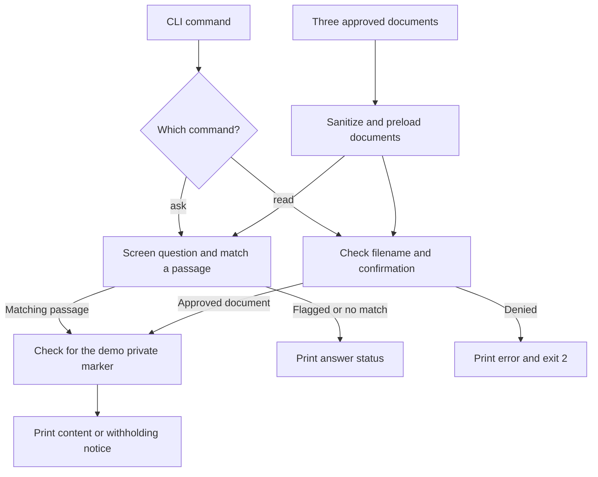

 AI Prompt Defense Lab

A small Python support chatbot that answers questions with excerpts from three ACME demo documents. It also lets a caller request a full document by name and explicitly approve that read. The lab runs offline with the Python standard library.

## 1. The scenario

A customer asks how long standard shipping takes. A teammate asks to see the full account FAQ. The first request needs a relevant passage and its source. The second needs an exact filename and confirmation before the chatbot returns the document.

```console
$ python -m support_lab ask "How long does standard shipping take?"
ACME Shipping Policy: Standard shipping takes 3-5 business days.
Source: 01-shipping-policy.txt
```

If a question has too little overlap with the corpus, the chatbot says it couldn't find an answer. Try the unrelated question in the exercises to see that path.

## 2. Architecture



| Component | Responsibility |
| --- | --- |
| Corpus and retrieval | `rag.py` loads three fixed filenames, splits text into passages, and selects the passage with the most shared keywords. A match needs at least two distinct terms. |
| Question handling | `HardenedChatbot.ask()` screens the question and returns a passage with its source filename when it finds a match. |
| Full-document access | `HardenedChatbot.read_document()` checks the exact name and requires boolean confirmation. It reads from the document store built at startup. |
| Defense checks | `defenses.py` flags selected wording in questions, redacts selected phrases in corpus text, and checks both response paths for a synthetic private marker. |
| Command line | `__main__.py` routes `ask` and `read`, prints the result, and returns exit status `2` for a denied read. |

## 3. Roadmap

The lab builds up from a small corpus to an end-to-end regression suite.

| Phase | Build step | How to verify it |
| --- | --- | --- |
| 0 | Bundle shipping, account, and product documents. | Match each topic to an approved filename. |
| 1 | Return the best matching passage. | Ask a support question and check the excerpt against its source. |
| 2 | Add an explicit document read. | Run the same read with and without `--confirm` and observe the result. |
| 3 | Apply phrase checks and output filtering. | Follow the tests that use a sample account banner and a synthetic private marker. |
| 4 | Verify the CLI and response paths together. | Run the regression suite and check that ordinary questions and approved reads still work. |

## 4. Setup and run

Use Python 3.10 or later. Run the examples from the repository root.

```sh
git clone https://github.com/ChanduKomme/ai-prompt-defense-lab.git
cd ai-prompt-defense-lab
python -m support_lab --help
```

```sh
python -m support_lab ask "How do I reset my password?"
python -m support_lab ask "What is the WidgetPro warranty?"
python -m support_lab read 02-account-faq.txt --confirm
python -m unittest discover -s tests -v
```

### Repository layout

| Path | Purpose |
| --- | --- |
| [`support_lab/__main__.py`](support_lab/__main__.py) | Command-line entry point |
| [`support_lab/chatbot.py`](support_lab/chatbot.py) | Question handling and confirmed document reads |
| [`support_lab/rag.py`](support_lab/rag.py) | Corpus loading and keyword matching |
| [`support_lab/defenses.py`](support_lab/defenses.py) | Phrase checks and synthetic marker filtering |
| [`data/corpus/`](data/corpus/) | The three ACME support documents |
| [`tests/test_chatbot.py`](tests/test_chatbot.py) | Retrieval, read-policy, filtering, and CLI regression tests |
| [`.gitignore`](.gitignore) | Excludes Python caches and local environment files |
| [`LICENSE`](LICENSE) | Original MIT license and copyright notice |

## 5. Security considerations

### 5.1 Question and document text

Question text can affect which passage the matcher selects. Corpus text can appear in an answer or a confirmed read. Python code owns the decision to return a passage or document. The phrase checks are supplemental and can flag ordinary wording or miss variations. Keyword matching can also miss paraphrases of otherwise supported questions.

### 5.2 Scope of a confirmed read

The application checks the requested name against the entries it loaded at startup. `--confirm` approves one CLI invocation. Omitting it or requesting an unapproved filename yields an error with no document text. Access to the files themselves follows the local filesystem permissions.

### 5.3 Response filtering and provenance

A normal `ask` result includes the filename so the reader can trace the passage. The output check looks for the single synthetic marker `LAB_PRIVATE_MARKER`, with case-insensitive matching. When it withholds an answer, the CLI prints the withholding notice alone. It applies the same check to confirmed reads.

### 5.4 Regression coverage

The 12 tests cover useful answers across all three topics, the unrelated-question fallback, all three approved reads, denied reads, and fixture-based redaction and withholding. The CLI tests verify a sourced answer and a denied read with empty standard output. [Test suite](tests/test_chatbot.py)

## 6. Exercises

1. **Trace a source.** Ask the shipping question from the scenario and compare the passage with the [shipping policy](data/corpus/01-shipping-policy.txt).
2. **Check the fallback.** Run `python -m support_lab ask "How do lunar eclipses work?"` and observe the missing-answer message.
3. **Verify the approval gate.** Run `python -m support_lab read 02-account-faq.txt`, then repeat with `--confirm`. Check when the FAQ text appears.
4. **Inspect the marker check.** Run `python -m unittest discover -s tests -k private_marker -v`. Follow the fixture in [the test suite](tests/test_chatbot.py) to see how it checks both response paths.

## 7. What changed from the upstream lab

| Upstream behavior | Standalone change |
| --- | --- |
| The offline simulator could return the context wrapper for an ordinary question. | The chatbot returns a matching passage and filename, with an explicit fallback for queries without a match. |
| The approved filenames and mock file store used different entries. | Retrieval and approved reads share the same preloaded documents. |
| The output check covered the answer field. | The synthetic marker check covers both answers and approved reads. |
| The saved evaluation recorded simulated attack outcomes. | The regression suite asserts support answers, source filenames, read decisions, and output handling with local fixtures. |

